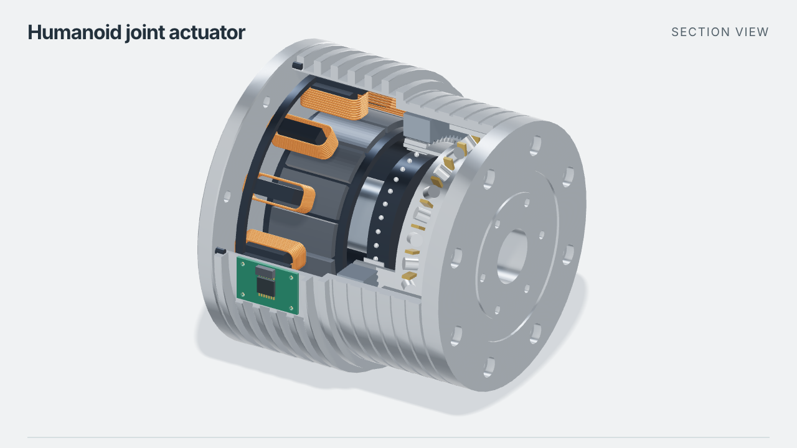
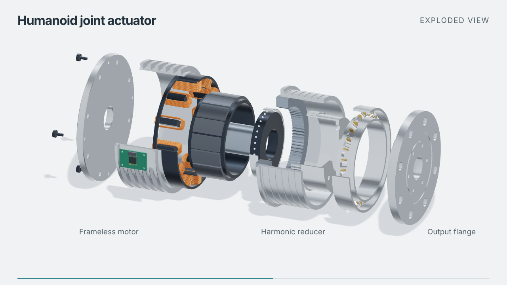
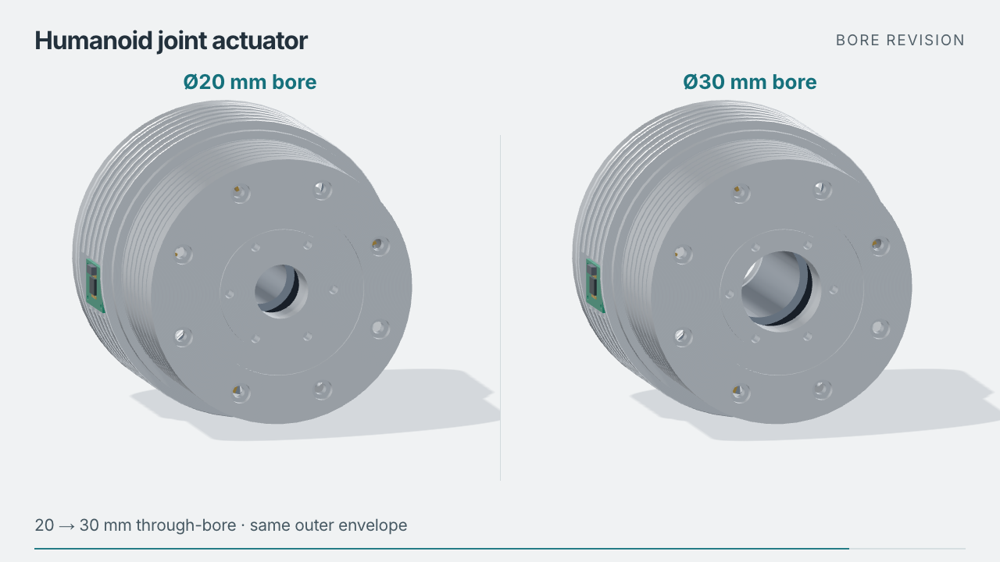

# Hollow-shaft joint actuator

**English** · [简体中文](README.zh-CN.md) · [Tool list](../../README.md)

A build123d model of a frameless motor and strain-wave reducer, based on a cutaway reference image. The dimensions below are chosen for this example.



[Ø20 STEP](generated/bore-20/assembly.step) · [Ø30 STEP](generated/bore-30/assembly.step) · [Model](model.py) · [Build and check records](run/README.md)

## Assembly

Copper windings surround a segmented rotor. The reducer contains an elliptical wave generator, a thin-wall flexspline, and a circular spline. Bearing races, rollers, an encoder board, and socket-head fasteners complete the assembly.



The flexspline and circular spline have 80 and 82 teeth. Their profiles are simplified, with clearance between the undeformed parts; flexspline deformation and tooth contact are not simulated. The cutaway and exploded views use the same CAD parts as the full assembly.

## Enlarge the bore



| Dimension | Baseline | Revision |
|---|---:|---:|
| Through-bore | 20 mm | 30 mm |
| Maximum housing diameter | 110 mm | unchanged |
| Overall length | 96 mm | unchanged |
| Rear mounting holes | 8 × Ø4.4 on Ø96 mm | unchanged |
| Front mounting holes | 8 × Ø4.4 on Ø80 mm | unchanged |

The two [configurations](config-20.json) differ only in [bore diameter](config-30.json). Six parts change: rear cover, rotor drum, hollow shaft, wave generator, flexspline, and output flange.

The [checker](check.py) reads the exported STEP geometry. Both variants pass: 56 named parts, 254 valid solids, clear through-bores, and no detected interference. The [revision report](run/revision.json) confirms unchanged outer dimensions and mounting interfaces.

## Run it

Python 3.12 and build123d 0.11.0. From this directory:

```bash
python3.12 -m venv .venv
source .venv/bin/activate
pip install -r requirements.txt
python model.py --config config-20.json --output generated/bore-20
python model.py --config config-30.json --output generated/bore-30
python check.py --self-test
python check.py generated/bore-20 generated/bore-30 --output run/check.json
```

The repository includes full-assembly and cutaway STEP files. The commands above regenerate individual part files for the checks and rendering. See [animation reproduction](video/README.md) for the GIF. The [earlier linear-stage example](../linear-stage-v2) remains available.
