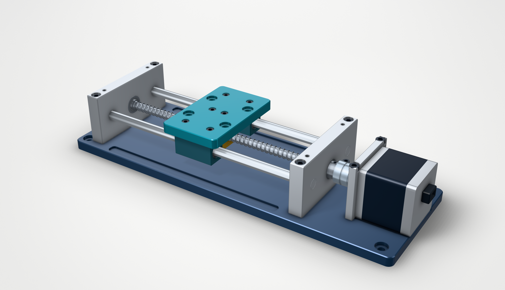

# Screw-driven linear stage

**English** · [简体中文](README.zh-CN.md) · [Back to the tool list](../../README.md)

Codex built this 59-part stage in build123d, then extended its travel from 80 to 120 mm while keeping the platform and motor interfaces.



[Assembly render](generated/assembly-120.png) · [80 mm STEP](generated/80/assembly.step) · [120 mm STEP](generated/120/assembly.step) · [Agent run record](run/README.md)

## Inside the assembly


The screw has a 4 mm lead: each quarter-turn moves the carriage 1 mm. The [part manifest](generated/120/manifest.json) lists materials, motion groups, and explosion offsets. The exploded view shows part relationships; its paths have not been checked as a disassembly sequence.

Static images use [text-to-cad](https://github.com/earthtojake/text-to-cad); the [animation](video/README.md) uses meshes from the same STEP parts.

## Change the travel


Only `travel` changes between [config-80.json](config-80.json) and [config-120.json](config-120.json).

| Dimension | 80 mm travel | 120 mm travel |
|---|---:|---:|
| Base length | 256 mm | 296 mm |
| Guide rod length | 168 mm | 208 mm |
| Platform | 52 × 82 × 8 mm | unchanged |
| Platform mounting pattern | 36 × 32 mm, four Ø5.5 holes | unchanged |
| Motor mounting pattern | 31 × 31 mm, four Ø3.4 holes | unchanged |
| Platform-to-end-support clearance at either travel limit | 6 mm | 6 mm |

[Geometric comparison](generated/revision-checks.json) confirms that the base, two guide rods, and screw change shape. The other 55 parts retain their local geometry; end supports and the motor assembly move to their new positions.

## What was checked

The [80 mm](generated/80/checks.json) and [120 mm](generated/120/checks.json) reports both pass: 59 valid single-solid parts, measured mounting holes and counterbores, and no detected interference in 15 sampled poses per variant. The poses cover both travel limits and quarter-turn screw phases. Selected drivetrain pairs are checked with two Boolean methods. An independent rebuild of the 80 mm model matches all 59 part geometries.

The screw-volume integrals differ between the native BREP and STEP by 0.103 mm³ and 0.501 mm³ for the two variants. Both directional geometry subtractions are empty; the measurements are in the check reports.

All parts are modeled here from nominal dimensions. The nut has a clearance bore; mating internal threads, bearing balls, fits, loads, and manufacturing tolerances are outside this example. The checks cover the modeled geometry and sampled operating poses.

## Run it

Tested with Python 3.12, build123d 0.11.0, and Open CASCADE 7.9.3. From this directory:

```bash
python3.12 -m venv .venv
source .venv/bin/activate
pip install -r requirements.txt
python model.py --config config-80.json --output generated/local-80
python model.py --config config-120.json --output generated/local-120
python check.py --self-test
python check.py generated/local-80
python check.py generated/local-120
python model.py --config config-80.json --output generated/local-rebuilt-80
python compare.py --baseline generated/local-80 --revised generated/local-120 --rebuilt generated/local-rebuilt-80
```

The full geometry checks took about 12–14 minutes per variant on the recorded machine. Saved outputs and reports are included for inspection without rebuilding.

Rendering uses a separate environment for cadgen's build123d version, plus Node.js 22 or later:

```bash
python3.12 -m venv .venv-render
.venv-render/bin/pip install -r requirements-render.txt
.venv-render/bin/python render.py
```

The recorded macOS run used installed Chrome via `CADGEN_CHROME_PATH="/Applications/Google Chrome.app/Contents/MacOS/Google Chrome"`. Set that environment variable if using the same setup; otherwise cadgen uses its own browser. Rendering writes a separate `view.step` with materials and animation metadata. The checked `assembly.step` stays the source model. See [animation reproduction](video/README.md) for the animation.

<details>
<summary>Rendering the first version</summary>

The left image is from the [first iteration](../linear-stage); the right renders its unchanged STEP with text-to-cad.

| First renderer | Same v1 STEP, text-to-cad |
|---|---|
|  |  |

Reproduce the right image with `.venv-render/bin/python render.py --baseline-only`.

</details>
