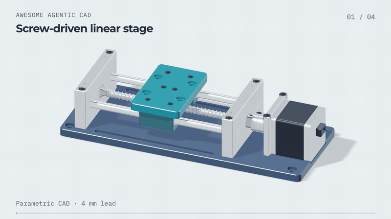
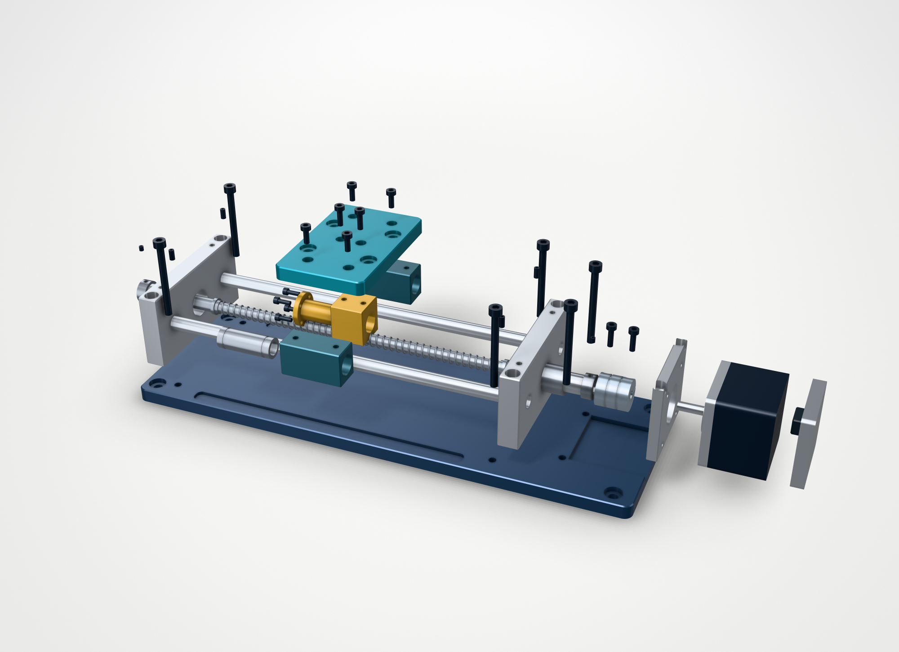
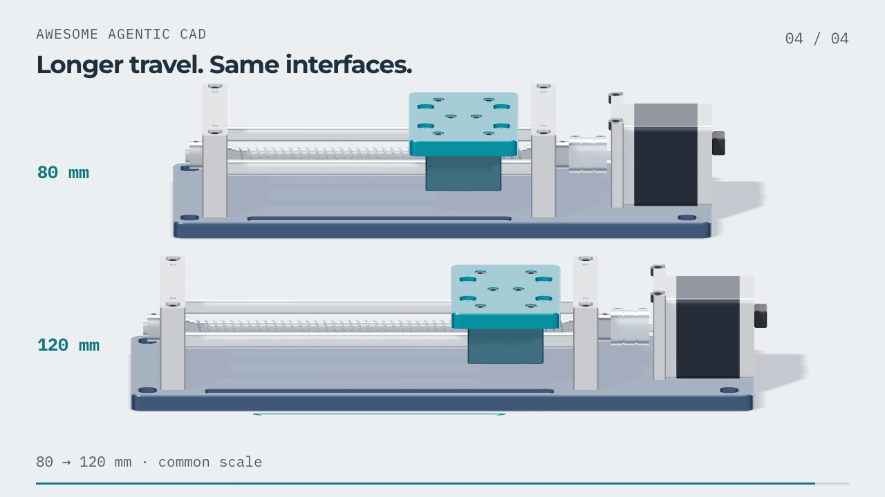
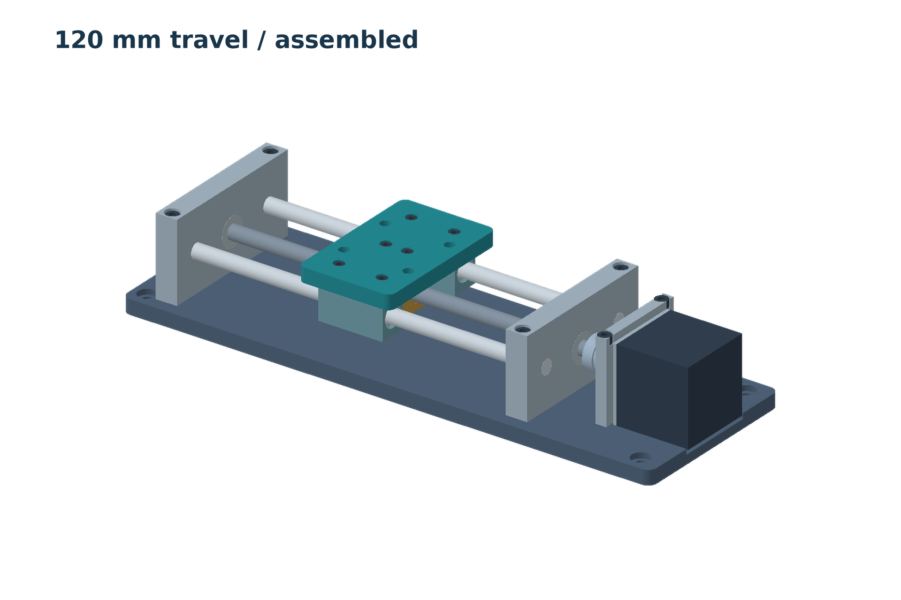
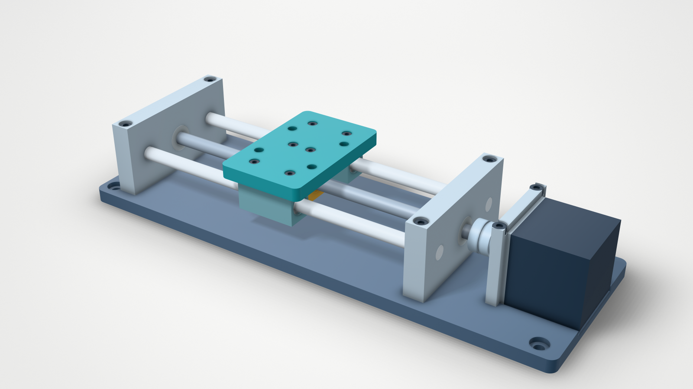

# 丝杆驱动直线滑台

[English](README.md) · **简体中文** · [返回工具列表](../../README.zh-CN.md)

Codex 使用 build123d 建立了这个 59 零件滑台，并将行程从 80 mm 增至 120 mm，同时保留平台与电机接口。



[装配渲染图](generated/assembly-120.png) · [80 mm STEP](generated/80/assembly.step) · [120 mm STEP](generated/120/assembly.step) · [Agent 运行记录](run/README.zh-CN.md)

## 看装配内部



丝杆导程为 4 mm，每转四分之一圈，平台移动 1 mm。[零件清单](generated/120/manifest.json)列出了材质、运动分组和爆炸偏移。爆炸图用于说明零件关系，其中的路径尚未作为拆装顺序进行检查。

静态图由 [text-to-cad](https://github.com/earthtojake/text-to-cad) 渲染；[动画](video/README.md)使用同一批 STEP 零件生成的网格。

## 修改行程



[config-80.json](config-80.json) 与 [config-120.json](config-120.json) 之间只改了 `travel`。

| 尺寸 | 80 mm 行程 | 120 mm 行程 |
|---|---:|---:|
| 底座长度 | 256 mm | 296 mm |
| 导杆长度 | 168 mm | 208 mm |
| 平台尺寸 | 52 × 82 × 8 mm | 不变 |
| 平台安装孔 | 36 × 32 mm 孔距，四个 Ø5.5 孔 | 不变 |
| 电机安装孔 | 31 × 31 mm 孔距，四个 Ø3.4 孔 | 不变 |
| 行程极限处的平台与端部支撑间隙 | 6 mm | 6 mm |

[几何对比](generated/revision-checks.json)确认，形状变化只发生在底座、两根导杆和丝杆上。其余 55 个零件保持原有局部几何；端部支撑与电机组件移到新的位置。

## 检查结果

[80 mm](generated/80/checks.json) 与 [120 mm](generated/120/checks.json) 两份报告均通过：59 个有效单实体零件，实测安装孔和沉孔尺寸符合要求，各 15 个采样姿态未发现干涉。采样包含两端行程极限和丝杆的四分之一转相位；部分传动零件对使用两种布尔方法交叉检查。独立重建的 80 mm 模型中，59 个零件的几何均与原版一致。

两种行程的丝杆原生 BREP 与 STEP 体积积分分别相差 0.103 mm³ 和 0.501 mm³，双向几何相减的结果均为空。测量值保留在检查报告中。

所有零件均按名义尺寸在本例中建模。螺母采用间隙孔，未建配合内螺纹和轴承滚珠，也未计算配合、载荷及制造公差。上述检查针对已建几何和采样的工作姿态。

## 运行

已使用 Python 3.12、build123d 0.11.0 和 Open CASCADE 7.9.3 跑通。在本目录执行：

```bash
python3.12 -m venv .venv
source .venv/bin/activate
pip install -r requirements.txt
python model.py --config config-80.json --output generated/local-80
python model.py --config config-120.json --output generated/local-120
python check.py --self-test
python check.py generated/local-80
python check.py generated/local-120
python model.py --config config-80.json --output generated/local-rebuilt-80
python compare.py --baseline generated/local-80 --revised generated/local-120 --rebuilt generated/local-rebuilt-80
```

本次机器上，每种行程的完整几何检查约需 12–14 分钟。仓库已附模型和报告，可直接查看。

渲染使用独立环境，以匹配 cadgen 的 build123d 版本，并需要 Node.js 22 或更新版本：

```bash
python3.12 -m venv .venv-render
.venv-render/bin/pip install -r requirements-render.txt
.venv-render/bin/python render.py
```

本次 macOS 渲染通过 `CADGEN_CHROME_PATH="/Applications/Google Chrome.app/Contents/MacOS/Google Chrome"` 使用已安装的 Chrome。采用同一环境时设置该变量即可；否则 cadgen 使用自己的浏览器。渲染会另存带材质和动画信息的 `view.step`，几何检查仍以 `assembly.step` 为源文件。动画的复现方法见[动画说明](video/README.md)。

<details>
<summary>第一版的渲染对比</summary>

左图为[第一版](../linear-stage/README.zh-CN.md)的原渲染；右图使用 text-to-cad 渲染同一份 STEP。

| 原渲染 | 同一份 v1 STEP，使用 text-to-cad |
|---|---|
|  |  |

执行 `.venv-render/bin/python render.py --baseline-only` 可复现右图。

</details>
