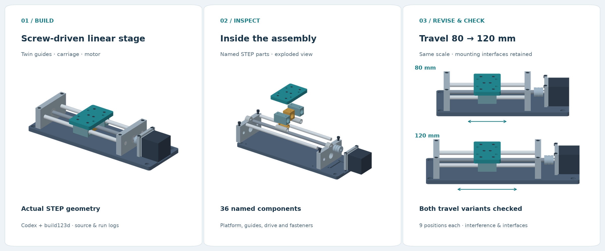

# A screw-driven linear stage: 80 → 120 mm travel

English · [简体中文](README.zh-CN.md) · [Back to the list](../../README.md)



Codex built this assembly with build123d, repaired five interference pairs found in the first check, then increased travel from 80 to 120 mm. The model has 36 named components, including 16 fasteners. The [run record](run/README.md) contains the commands, failures, source snapshots, and check outputs from this conversation.

## What changed

The [brief](brief.md) asks for a twin-guide stage with a four-hole platform interface. The revision extends its travel while retaining the platform and motor interfaces.

| Property | Original | Revised |
|---|---:|---:|
| Working travel | 80 mm | 120 mm |
| Base length | 256 mm | 296 mm |
| Guide-rod length | 168 mm | 208 mm |
| Platform mounting pattern | 36 × 32 mm, 4 × Ø5.5 | Unchanged |
| Motor mounting pattern | 31 × 31 mm, 4 × Ø3.4 clearance | Unchanged |
| Platform-to-end-support gap at travel endpoints | 6 mm | 6 mm |

STEP comparison found geometry changes in the base, two guide rods, and lead screw. The other parts retain their local geometry; supports and the motor assembly move to suit the longer stage. Rebuilding 80 mm travel with the final code reproduced the frozen baseline geometry.

## Inspect the result

- **Views:** [assembly](generated/assembly.png), [exploded](generated/exploded.png), [travel comparison](generated/travel-comparison.png).
- **STEP assemblies:** [80 mm](generated/80/assembly.step), [120 mm](generated/120/assembly.step).
- **Individual parts:** [80 mm](generated/80/parts), [120 mm](generated/120/parts); names, colors, bounds, and volumes are in each variant's `manifest.json`.
- **Checks:** [80 mm](generated/80/checks.json), [120 mm](generated/120/checks.json), [revision comparison](generated/revision-checks.json), [collision cross-check](generated/collision-audit.json).

Both variants contain 36 valid single-solid parts after STEP reimport. Fixed-part and carriage-part pairs were checked, plus carriage-to-fixed pairs at nine positions per variant, including both endpoints. No overlapping volume above 0.00001 mm³ was found in the final models. Circular edges in the saved parts confirm the mounting-hole patterns.

This is a geometric assembly example. Threads, bearings, and the motor use simplified geometry; fits, retention details, loads, and drive performance have not been engineered for fabrication.

## Run it

Tested with Python 3.12; exact library versions are in [environment.json](run/environment.json). From this directory, in a virtual environment:

```sh
python -m pip install -r requirements.txt
python model.py --config config-120.json --output my-120
python check.py my-120
```

Use `config-80.json` for the original travel. [model.py](model.py) keeps travel-dependent lengths and placements together; the revision changes only the `travel` value.

To repeat the old-configuration regression against the committed baseline:

```sh
python model.py --config config-80.json --output generated/rebuilt-80
python check.py generated/rebuilt-80
python compare.py
python audit.py
```

Keep `generated/80` as the frozen reference when running `compare.py`. [render.py](render.py) reads the committed STEP parts to regenerate the README and detail images. Run `python render.py`; use `--font /path/to/cjk-font.ttf` if a Chinese font is not installed.
