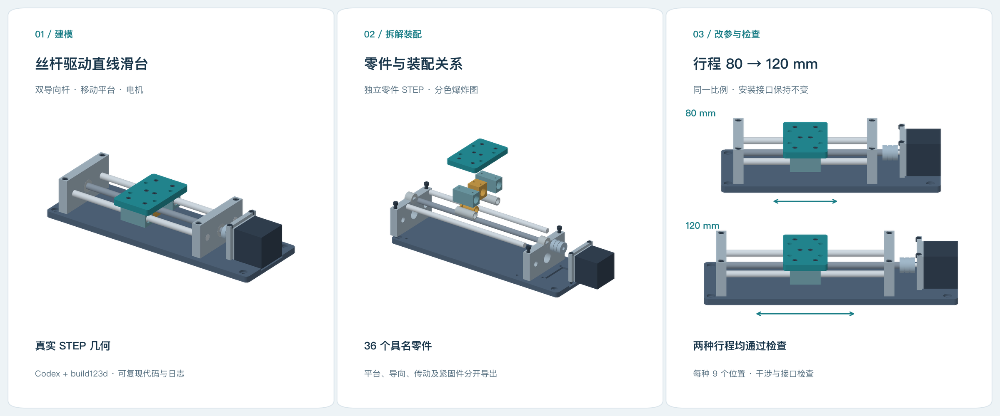

# 丝杆驱动直线滑台：行程 80 → 120 mm

[English](README.md) · 简体中文 · [返回工具清单](../../README.zh-CN.md)



Codex 使用 build123d 建立了这个装配，修复首轮检查发现的 5 对零件干涉，再将行程从 80 mm 增加到 120 mm。模型包含 36 个具名零件，其中 16 个为紧固件。[运行记录](run/README.zh-CN.md)保留了本次对话中的执行命令、失败输出、代码快照和检查结果。

## 改了什么

[需求](brief.md)是设计一个带四孔平台接口的双导向杆滑台，再增加行程，保持平台与电机接口。

| 项目 | 原始版本 | 修改后 |
|---|---:|---:|
| 工作行程 | 80 mm | 120 mm |
| 底座长度 | 256 mm | 296 mm |
| 导向杆长度 | 168 mm | 208 mm |
| 平台安装孔阵列 | 36 × 32 mm，4 × Ø5.5 | 保持不变 |
| 电机安装孔阵列 | 31 × 31 mm，4 × Ø3.4 间隙孔 | 保持不变 |
| 行程端点的平台至端座间隙 | 6 mm | 6 mm |

STEP 几何比较确认，改形的零件为底座、两根导向杆和丝杆。其他零件保持自身几何，端座与电机组件随滑台加长而移位。使用最终代码重建 80 mm 行程后，几何与冻结的基准一致。

## 查看结果

- **图片：**[装配图](generated/assembly.png)、[爆炸图](generated/exploded.png)、[行程对比](generated/travel-comparison.png)。
- **STEP 装配：**[80 mm](generated/80/assembly.step)、[120 mm](generated/120/assembly.step)。
- **独立零件：**[80 mm](generated/80/parts)、[120 mm](generated/120/parts)；每个版本的 `manifest.json` 记录名称、颜色、包围盒和体积。
- **检查结果：**[80 mm](generated/80/checks.json)、[120 mm](generated/120/checks.json)、[改参比较](generated/revision-checks.json)、[干涉交叉核对](generated/collision-audit.json)。

两个版本的 36 个零件在重新读取 STEP 后均为有效的单一实体。检查覆盖固定组件内部、滑动组件内部，以及每种行程中包含两端点的 9 个位置上的动静零件配对。最终模型中未发现超过 0.00001 mm³ 的重叠体积；安装孔阵列通过读取保存零件中的圆形边线核对。

这是一个几何装配示例。螺纹、轴承和电机采用简化几何；配合公差、轴向固定细节、载荷和驱动性能尚未按制造要求设计。

## 运行

已在 Python 3.12 下执行，具体依赖版本见 [environment.json](run/environment.json)。在 Python 虚拟环境中，进入本目录运行：

```sh
python -m pip install -r requirements.txt
python model.py --config config-120.json --output my-120
python check.py my-120
```

原始行程使用 `config-80.json`。[model.py](model.py) 统一推导与行程有关的尺寸和位置；这次改参只改变配置中的 `travel` 值。

要对照仓库中保存的基准，重跑旧尺寸回归检查：

```sh
python model.py --config config-80.json --output generated/rebuilt-80
python check.py generated/rebuilt-80
python compare.py
python audit.py
```

运行 `compare.py` 时保留 `generated/80` 作为冻结基准。[render.py](render.py) 读取保存的 STEP 零件，重新绘制中英文首页图片和细节图。执行 `python render.py` 即可；缺少中文字体时，可用 `--font /path/to/cjk-font.ttf` 指定字体文件。
